# Summary {.unnumbered}

Slow oscillations (SOs), sleep spindles and SO–spindle complexes lock to the breathing cycle in healthy sleepers
[@Schreiner2023; @BullonTarraso2026]. In this project I asked whether this coupling survives the disordered breathing
of a sleep-clinic cohort (DREAMT, 100 overnight PSGs; @Wang2024), whether it changes during apneas, hypopneas and
snoring, and whether it scales with disease severity.

The analysis was carried out with a coding agent (Claude Code). I set the questions, made the methodological
decisions and checked the outputs. The agent wrote the pipeline, ran the analyses and reported back after each step.
Section [-@sec-workflow] describes how to rerun everything. Section [-@sec-agent] describes what was delegated, what I
decided, how outputs were verified, and the mistakes the agent made along the way.

**Code and pipeline:** <https://github.com/EstebanBT/SnoreDREAMT>

::: {.callout-note title="Main findings"}
1. **Replication.** SOs and spindles are coupled to breathing during undisturbed (clean) NREM sleep at the group
   level (FLOW Hilbert phase: SO R = 0.31, spindle R = 0.33, Rayleigh p ≤ 1e-4). Complexes are coupled only once SOs
   and spindles are pooled across channels, and most complexes are chance SO–spindle pairings. Arousals and REM
   pseudo-SOs are not coupled (negative controls).
2. **Apneas and hypopneas do not abolish coupling.** A complete loss is excluded (P ≤ 2 %), and a loss of more than
   ~50 % is unlikely (P ≈ 2–7 %).
3. **Snoring.** The apparent *increase* of SO coupling during snoring is produced by snore-evoked K-complexes and
   spindles timed by the inspiratory snore burst. Once those events are removed, coupling of SOs, spindles and
   complexes drops by roughly 60–80 % (one-sided p ≈ 0.03–0.08). This is trend-level, and the exclusion windows
   were chosen from the same data.
4. **Preferred phase.** Pooled over all events, spindles shift within the breathing cycle without losing modulation:
   about +45° during hypopneas and respiratory events, and about −40° to −70° during snoring. Much of the spindle
   "loss" during snoring is therefore a phase shift. No consistent shift is detectable within individual participants,
   who contribute too few events.
5. **Severity.** AHI and data-derived severity markers are unrelated to either coupling strength or preferred phase in
   clean breathing (all FDR ≥ 0.3). Coupling behaves as a **state** property of ongoing breathing, not a trait that
   scales with disease severity.
:::

# Research question and approach

## Background

@Schreiner2023 showed that SOs, spindles and their complexes are modulated by the respiratory cycle in healthy
sleepers, and @BullonTarraso2026 showed that breathing gates memory reactivation during NREM sleep. Sleep-disordered
breathing perturbs the breathing rhythm naturally: airflow stops (apnea), drops (hypopnea) or becomes turbulent
(snoring) while the brain stays asleep.

## Questions and expected outputs

- **(i) Replication:** does the coupling replicate in a clinical cohort during undisturbed breathing? Output: group
  Rayleigh/V-tests of subject preferred phases, with negative controls.
- **(ii) Breathing conditions (main question):** does coupling change during obstructive, central and mixed apneas,
  hypopneas and snoring? Output: within-subject contrasts of coupling strength and preferred phase, condition vs
  clean breathing.
- **(iii) Severity:** does coupling relate to the apnea–hypopnea index (AHI) and other severity markers? Output:
  per-subject regressions and correlations with FDR control.

## Data: the DREAMT dataset

### Cohort and recording

DREAMT (*Dataset for Real-time sleep stage EstimAtion using Multisensor wearable Technology*; @Wang2024) was
collected to develop wearable sleep trackers for people with sleep disorders. It contains one night of clinical
polysomnography (PSG) from each of 100 adults referred to the Duke Sleep Disorders Center for a diagnostic sleep study
(May–September 2022).

- **Inclusion:** there were no selection criteria beyond attending the clinic; the cohort is a typical sleep-clinic
  population, mostly suspected of sleep apnea.
- **Recording:** the Nihon Kohden Polysmith system, in single rooms of the sleep lab, roughly from 10 PM to 6 AM.
- **Release format:** one file per participant, with all PSG signals resampled to a common 100 Hz grid.
  The dataset is hosted on PhysioNet under a credentialed licence.

| Analysed cohort (N = 98) | Median [IQR] or count |
|---|---|
| Age (years) | 58.7 [42.6, 69.8], range 21–87 |
| Sex | 53 female, 45 male |
| BMI (kg/m²) | 32.0 [29.0, 37.8] |
| AHI (events/h) | 13.5 [4.0, 29.0], range 0–182 |
| AHI category: < 5 (normal) / 5–15 (mild) / 15–30 (moderate) / ≥ 30 (severe) | 30 / 22 / 24 / 22 |
| Clinical arousal index (events/h) | 28 [20, 49] |
| Mean SaO2 (%) | 95, range 77–99 |
| Recording length (h) | 6.4, range 4.5–7.8 |
| Median minutes per stage: W / N1 / N2 / N3 / REM | 60 / 35 / 208 / 0.25 / 40 |

: Characteristics of the analysed cohort (clinical values from `participant_info.csv`; stage minutes from the
  hypnograms). {.striped}

### Channels

The columns used in this project are listed below. Labels follow the international 10–20 electrode system:
F = frontal, C = central, O = occipital, T = temporal, Z = midline. Odd numbers are on the left, even numbers on
the right, and M1 is the left mastoid (the bone behind the ear), used as reference.

| Column | Signal | What it measures | Use in this project |
|---|---|---|---|
| `C4-M1` | EEG | right central scalp vs left mastoid | spindle detection (primary); arousal detection |
| `F4-M1` | EEG | right frontal scalp vs left mastoid; SOs are largest frontally | SO and complex detection (primary) |
| `O2-M1` | EEG | right occipital scalp vs left mastoid | multichannel consensus SOs and spindles (Step 3b–3d) |
| `T3 - CZ`, `CZ - T4` | EEG (bipolar) | left temporal vs vertex; vertex vs right temporal; no mastoid reference | consensus spindles, pooled complexes; check against mastoid/ECG artefact |
| `CHIN` | EMG | submental (chin) muscle tone | arousal detection (EMG criterion) |
| `ECG` | ECG | heart's electrical activity | R-peaks: respiratory polarity check (heart rate rises in inspiration) and artefact checks |
| `FLOW` | airflow (thermal) | oronasal thermistor: temperature change of the breathed air | respiratory phase (Step 2 replication; `BEST` phase) |
| `PTAF` | airflow (pressure) | nasal pressure transducer | validation of snoring (airflow flutter); saturates in many subjects |
| `THORAX`, `ABDOMEN` | respiratory effort | inductance belts around chest and abdomen; they keep moving during obstructive apneas | `ABDOMEN` phase: primary for all condition contrasts; `THORAX` for polarity |
| `SNORE` | sound | snore sensor (physical type not documented) | snoring detection (20–45 Hz energy per breath) |
| `SAO2` | oximetry | blood oxygen saturation (%) | oxygen desaturation index, T90, hypoxic burden (Step 4) |
| `TIMESTAMP` | – | seconds since recording start | time axis |

: DREAMT columns used in this project {.striped}

### Annotations

- **`Sleep_Stage`:** 30-s epochs scored by the clinic's technicians: P (preparation, before the PSG starts), W, N1,
  N2, N3, R (REM) and Missing. P and Missing epochs are excluded.
- **`Obstructive_Apnea`, `Central_Apnea`, `Hypopnea`:** sample-wise 0/1 labels of respiratory events, added
  retrospectively by expert technicians.
  - An **apnea** is a near-complete stop of airflow. It is **obstructive** when breathing effort continues against a
    closed airway, and **central** when the effort stops too.
  - A **hypopnea** is a partial reduction of airflow, usually with an oxygen desaturation or an arousal.
  - The exact scoring rules used in DREAMT (for example 3 % vs 4 % desaturation for hypopneas) are not reported.
- **`Multiple_Events`:** documented in the metadata as *mixed apnea* (central at the start, then obstructive). It never
  overlaps the other labels and is treated as mixed apnea.
- **`participant_info.csv`:** age, sex and BMI (covariates); AHI and obstructive AHI (OAHI; severity); mean SaO2 and
  the clinical arousal index (to check our own measures); medical history (only to flag depression, a proxy for
  antidepressant use, in a sensitivity analysis).

**Not labelled**, and therefore detected in this project:

- **Arousals:** brief awakenings, i.e. abrupt shifts of the EEG to faster activity lasting at least 3 s.
- **Snoring:** vibration of the upper airway during inspiration, heard as noise.

::: {.callout-note title="Severity measures used in the report"}
- **AHI:** apnea–hypopnea index, the number of apneas plus hypopneas per hour of sleep. Clinically < 5 is normal,
  5–15 mild, 15–30 moderate and ≥ 30 severe sleep apnea.
- **OAHI:** the same, counting only obstructive events.
- **ODI3:** oxygen desaturations of ≥ 3 % per hour.
- **T90:** percentage of sleep with SaO2 below 90 %.
- **Hypoxic burden:** area of the desaturations following respiratory events, per hour.
- **Snore index:** percentage of N2 breaths classified as snoring.
:::

### Data properties and how they were handled

| Data property | Handling |
|---|---|
| EEG stored in volts, although the metadata says µV | rescaled to µV |
| S097 (EEG and respiration flat), S077 (zeros / 1e18 values) | excluded → 98 subjects |
| FLOW near zero for half the night (S016, S102); flat FLOW epochs in ~10 subjects | per-epoch validity masks |
| PTAF saturates at ±3.2 mV | used only where not clipped |
| Respiratory polarity (whether inspiration goes up or down) and FLOW–belt lag differ between subjects | per-subject polarity calibration |
| US recording (60 Hz mains) resampled to 100 Hz | checked for a 40 Hz alias before using > 16 Hz power |

: Data integrity and how it was handled {.striped}

**Feasibility** (from all files, N2/N3): clean NREM ≥ 60 min in 90 subjects; hypopneas ≥ 20 events in 47; obstructive
apneas ≥ 20 events in 13; central apnea ≥ 10 min in 6; mixed apnea ≥ 10 events in 3. N3 is scarce (median 0.25 min;
none in 49 nights), so all analyses are effectively N2. AHI is unrelated to age (ρ = 0.01) and weakly related to BMI
(ρ = 0.21) and to the clinical arousal index (ρ = 0.44).

## Approach

The work ran in steps; each step ended with a written report and figures that I reviewed before the next step.

| Step | Question |
|---|---|
| 0 | data cache, quality masks, literature notes |
| 1 | SO, spindle and complex detection (port of my MATLAB `+slythm` detectors) |
| 2 | respiratory phase; replication of the coupling in clean NREM; arousal detection |
| 3 (3b–3d) | coupling **strength** per breathing condition |
| 4 | coupling strength vs severity |
| 5 | coupling **preferred phase** per breathing condition |
| 6 | phase effects vs severity |

: Analysis steps {.striped}

Key decisions:

- All breathing conditions are analysed as group tests, and Ns are reported honestly.
- The phase for condition contrasts is the abdominal belt (ABDOMEN), using a breath-gated Hilbert phase of a narrow
  band-pass around the subject's respiratory peak (±0.05 Hz). The Step 2 replication is shown with both FLOW and
  ABDOMEN.
- Arousals are detected with the rule-based method of @FernandezVarela2017, validated in @AlvarezEstevez2019, with
  two modifications (Section [-@sec-arousal-det]).

# Results and interpretation

## Step 0 — Data quality and literature

::: {.callout-important title="Objective"}
Make the raw recordings trustworthy and quick to use before any analysis. We wanted to find the data problems (wrong
units, broken recordings, sensors that fall off during the night) before they could contaminate results, and to have
the methods of the key papers in a form the agent could follow exactly.
:::

- **Cache.** Each subject is loaded once into float32 µV arrays with the stage vector (`P` and `Missing` excluded) and
  event masks.
- **Quality masks** per channel and 30 s epoch: flat, saturated, or amplitude below 10 % of the subject's typical
  level. For EEG, additionally robust-z outliers of amplitude, < 0.5 Hz power (sweat) and 20–40 Hz power, padded ±1 s.
  Every analysis uses a sample only if all channels it depends on are valid.
- **ECG R-peaks** were detected for artifact checks and for the respiratory polarity calibration.
- **Literature** was processed into structured notes with a reusable agent Skill (Section [-@sec-agent-ready]).

## Step 1 — SO, spindle and complex detection

::: {.callout-important title="Objective"}
Detect SOs, spindles and SO–spindle complexes exactly as in our previous work on healthy sleepers, so that any
difference to those studies comes from the cohort and not from the method. We wanted to verify that the Python
detectors are identical to the MATLAB originals, and that they are specific: they should find many events in NREM
and few in REM and wake.
:::

The MATLAB `+slythm` detectors were ported to Python (`snoredreamt/detectors.py`).

- **SOs:** F4-M1, Butterworth 0.3–1.5 Hz, negative-to-positive cycles of 0.8–2 s. Both trough and peak-to-peak must
  exceed 2.5 × the median of in-stage, artifact-free candidates.
- **Spindles:** C4-M1, 12–16 Hz, 0.2 s moving RMS, 0.5–3 s above 2.0 × the median envelope, plus a spectral-peak
  criterion (sigma power above 8–11 Hz and 18–25 Hz power). The original slythm threshold (1.5 ×) is a sensitivity
  analysis.
- **Thresholds** are computed once per subject over all valid N2/N3, never per breathing condition.
- **Complexes:** a spindle within (0, 1.5] s after the SO trough.

**MATLAB parity** (S003, 2 h segment, F4-M1 and C4-M1): SOs 285/285 and 255/255, spindles 902/902 and 1165/1165, all
matched within ±2 samples, with identical thresholds.

| Event (channel) | N2 | N3 | REM | Wake |
|---|---|---|---|---|
| SOs (F4) | 3.11 | 0.67 | 0.29 | 1.04 |
| Spindles (C4) | 3.36 | 2.20 | 0.34 | 1.26 |
| Complexes (F4) | 0.20 | 0.02 | – | – |

: Median event density (events/min) per stage. REM and wake were detected with N2 thresholds as a specificity check.
  N3 SO densities are low because N3 is scarce and uses its own threshold where ≥ 10 min exist. {.striped}

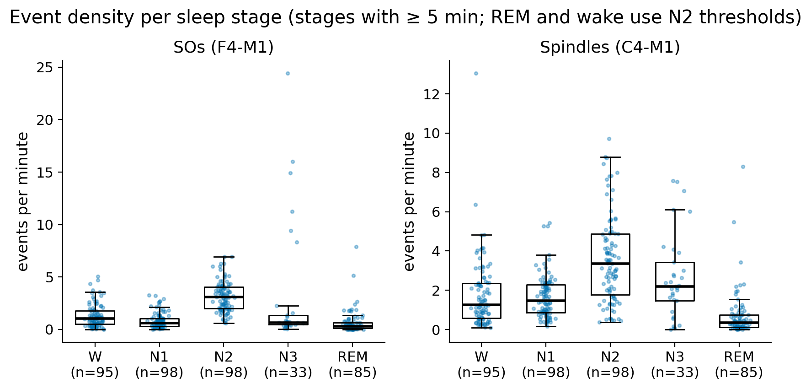{#fig-step1}

## Step 2 — Respiratory phase and replication

::: {.callout-important title="Objective"}
Establish that the effect we want to perturb exists in this cohort. Before asking whether disordered breathing changes
the coupling, we had to:

1. obtain a reliable respiratory phase for each subject, despite varying sensors and signal polarity;
2. replicate the coupling of SOs, spindles and complexes to breathing during undisturbed NREM sleep;
3. show with negative controls (arousals, SO-like events in REM) that the coupling is not an artefact;
4. build an arousal detector, because arousals had to be excluded from all later comparisons.

Without baseline coupling, Step 3 would be meaningless.
:::

### Respiratory phase

- **Breaths** were detected on FLOW, ABDOMEN and THORAX, with prominence relative to the subject's breath amplitude.
- **Inspiratory polarity** was calibrated per subject from anchors that must agree: inspiration shorter than
  expiration, heart-rate rise during inspiration, and SNORE bursts. Unresolved polarity: 19 of 98 subjects for
  ABDOMEN, 3 for FLOW. Group phase tests use polarity-unambiguous subjects; within-subject contrasts are polarity-free.
- **Phase methods:**
  - **Hilbert:** for each participant and each sensor (FLOW and ABDOMEN), the breathing frequency f0 was taken as the
    peak of the mean Welch spectrum of 60-s segments of clean NREM (0.1–0.6 Hz; f0 = 0.15–0.42 Hz, median 0.25 Hz).
    The whole night was then band-passed at f0 ± 0.05 Hz (Butterworth, order 4, forward and backward) and the phase
    taken as `angle(hilbert)`. Its occupancy is uniform (R ≈ 0.002).
  - **Gated Hilbert:** the same phase, set to NaN where no breath is detected in the raw signal. This removes filter
    ringing through apneas.
  - **Cycle-based:** linear interpolation between detected peaks and troughs. It over-represents expiration
    (occupancy R ≈ 0.09–0.16) and therefore needs equalisation.
- **Clean NREM** = N2/N3, valid channels, ≥ 5 s before and ≥ 15 s after any respiratory event, not snoring, and not
  within ±5 s of a detected arousal.

{#fig-phase}

### Arousal detection {#sec-arousal-det}

Arousals had to be detected, because DREAMT does not label them. The detector is a Python port of the
Fernández-Varela / Alvarez-Estevez rule-based method, using C4-M1 and chin EMG (`snoredreamt/arousals.py`, rule
`arousals_extended`). It has two modifications to the published rules:

- alpha-band arousals in N2/N3 are accepted without a chin-EMG increase, because clinical rules require an EMG
  increase only for arousals in REM;
- candidates that start in sleep and end in an epoch scored as wake are kept.

Compared with the clinical arousal index of the 98 subjects, the detection ranks subjects reasonably well (Spearman
ρ = 0.67) but detects fewer arousals: median 20 against 28 per hour (Bland–Altman bias −15/h, 95 % limits −51 to
+21/h; ICC for absolute agreement 0.47, for consistency 0.59). The log–log slopes in the two directions (0.41 and
0.92) are both below 1, so the undercount is relatively larger in subjects with many arousals. The clinical index's
scoring rules and denominator are not reported. Detected arousals ±5 s are excluded from every analysis window, and
the detected index is used only as a ranking.

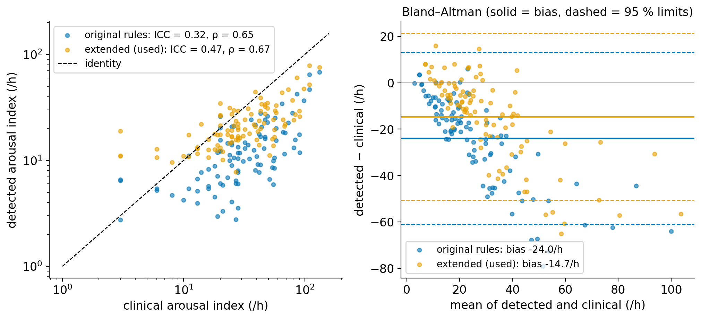{#fig-arousal-val}

### Coupling in clean NREM

Event phase is taken at the SO trough, spindle onset and complex SO trough. Group tests use the subjects' preferred
phases: Rayleigh for non-uniformity, and a V-test against 0°, where 0° is the inspiration peak.

| Event | Phase | N | Group mean | R | Rayleigh p | V-test p |
|---|---|---|---|---|---|---|
| SOs | FLOW Hilbert | 92 | +17° | 0.31 | 1.0e-4 | 2.4e-5 |
| SOs | FLOW gated | 92 | +22° | 0.32 | 5.5e-5 | 2.3e-5 |
| SOs | ABDOMEN gated | 76 | −68° | 0.23 | 0.015 | 0.13 |
| Spindles | FLOW Hilbert | 90 | +44° | 0.33 | 4.7e-5 | 7.2e-4 |
| Spindles | ABDOMEN gated | 73 | −2° | 0.29 | 0.0022 | 2.6e-4 |
| Complexes | FLOW Hilbert | 52 | +5° | 0.19 | 0.16 | 0.028 |
| Complexes | ABDOMEN gated | 45 | −58° | 0.18 | 0.22 | 0.18 |
| Arousals | FLOW Hilbert | 87 | – | 0.01 | 0.99 | 0.55 |
| REM pseudo-SOs (control) | FLOW Hilbert | 20 | – | 0.04 | 0.96 | 0.43 |

: Step 2 group coupling in clean NREM (polarity-unambiguous subjects). {.striped}

About 25–31 % of subjects show individually significant SO or spindle coupling. The FLOW–ABDOMEN difference in
preferred phase reflects the lag between airflow and belt.

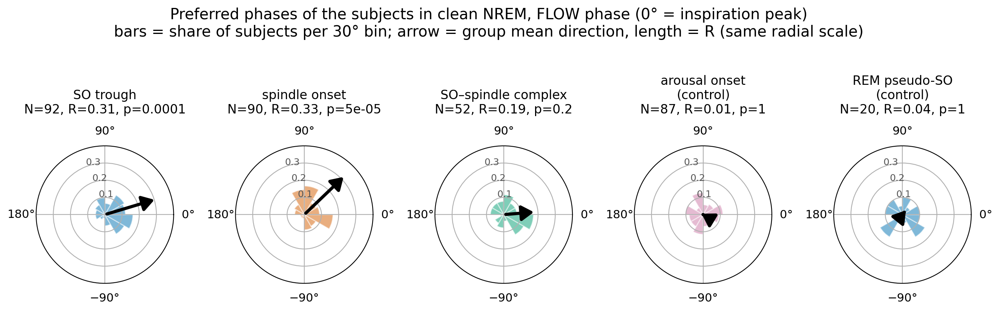{#fig-polar}

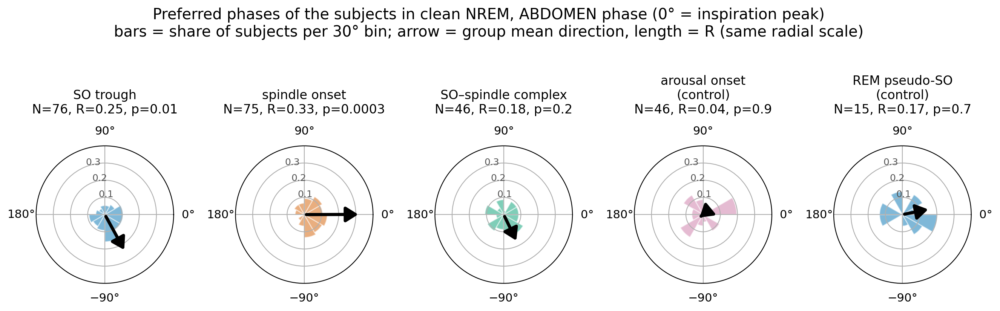{#fig-polar-abd}

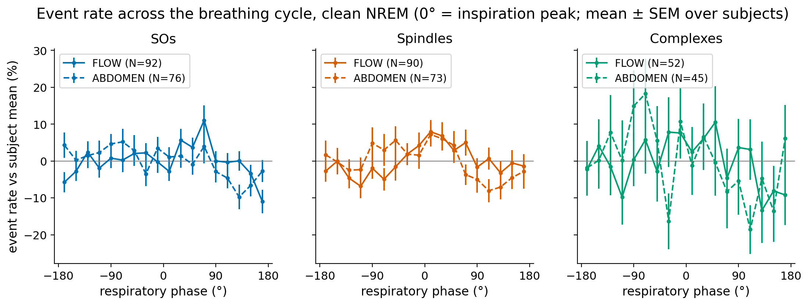{#fig-rates}

## Step 3 — Coupling strength per breathing condition

::: {.callout-important title="Objective"}
The main question: **does coupling weaken when breathing is disturbed?** Each condition (obstructive, central and
mixed apnea, hypopnea, the recovery period after an event, and snoring) was compared within each subject with clean
breathing.

Our hypothesis was that coupling depends on a regular breathing rhythm, or on airflow through the nose. It should
then weaken when airflow stops (apneas), drops (hypopneas) or becomes turbulent (snoring). Central apneas, with no
breathing movement at all, would be the strongest test, but few subjects have enough of them.
:::

### Conditions and controls

- **Post-event window, set from the data.** Within 0–4 s after an event ends the SO rate is 1.7× and the arousal rate
  about 8× the clean rate. Both return to baseline by ~10 s, so a 15 s "recovery" window was kept. At event onset, SO and
  spindle rates drop to about 0.5×.
- **Snoring per breath.** SNORE 20–45 Hz RMS ≥ the quiet reference + 10 dB, phasic (louder half-cycle ≥ 2× the
  quieter one), in ≥ 3 consecutive breaths. In clear snorers, snoring breaths carry 1.6–4× more PTAF flutter.
- **Label priority:** obstructive > central > mixed > hypopnea > recovery (15 s) > pre-event (5 s, excluded) >
  arousal (±5 s, excluded) > snoring > clean.
- **Feasibility (≥ 5 min in N2):** clean 96, snoring 52, hypopnea 58, recovery 52, obstructive 12, central 7, mixed 2
  subjects. Apneas therefore stay descriptive.
- **Matched controls:** clean samples from the same subject and stage within ±10 min, of equal duration.
- **Metric:** projected coupling, i.e. the mean cos(θ − μ), on the subject's own clean phase and on the
  leave-one-subject-out group phase. Subject preferred phases proved unreliable: split-half agreement within 45° was
  30 % for SOs against 25 % chance.

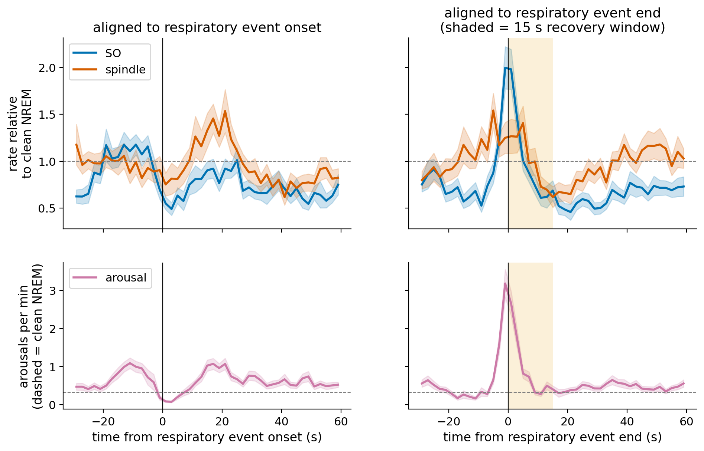{#fig-locked}

**Check per event type.** The pooled curve is 70 % hypopneas, and obstructive apneas typically end with a stronger
arousal response than central apneas, so the response was also computed for each type (`event_locked_by_type`
rule). Mixed apneas (4 subjects) are too few to show.

- **All types:** the SO rate returns to the clean level 4–8 s after the event end, and arousals 8–12 s after it.
  Spindles are never clearly above the clean level.
- **The 15 s window therefore holds for all types.** The obstructive result is the same without the subject
  contributing most obstructive events (S058, 17 %).
- **Arousal rates beyond the window:** they stay about 1.3× the clean rate up to 30 s after hypopneas and in the pooled
  curve, and show a second rise 12–16 s after central apneas. This probably reflects the next event following soon.
  Arousal windows are excluded separately, so this does not contaminate the breathing conditions.

| Event type | Subjects (events) | SOs 0–4 s | SOs 4–8 s | Arousals 0–4 s | Arousals 8–12 s |
|---|---|---|---|---|---|
| Hypopnea | 63 (3746) | 1.82 [1.44, 2.20] | 0.96 [0.77, 1.15] | 7.5 [5.6, 9.8] | 1.0 [0.6, 1.5] |
| Obstructive apnea | 19 (571) | 1.61 [0.98, 2.23] | 0.98 [0.26, 1.70] | 7.9 [5.6, 10.8] | 0.4 [0.1, 0.8] |
| Central apnea | 21 (519) | 1.25 [0.56, 1.95] | 0.72 [0.41, 1.03] | 4.0 [2.4, 6.4] | 1.1 [0.4, 2.1] |
| Pooled | 69 (4991) | 1.72 [1.39, 2.05] | 0.94 [0.77, 1.11] | 6.8 [5.3, 8.7] | 0.9 [0.7, 1.3] |

: Event rates after the end of each respiratory-event type, relative to clean NREM (mean and 95 % CI). {.striped}

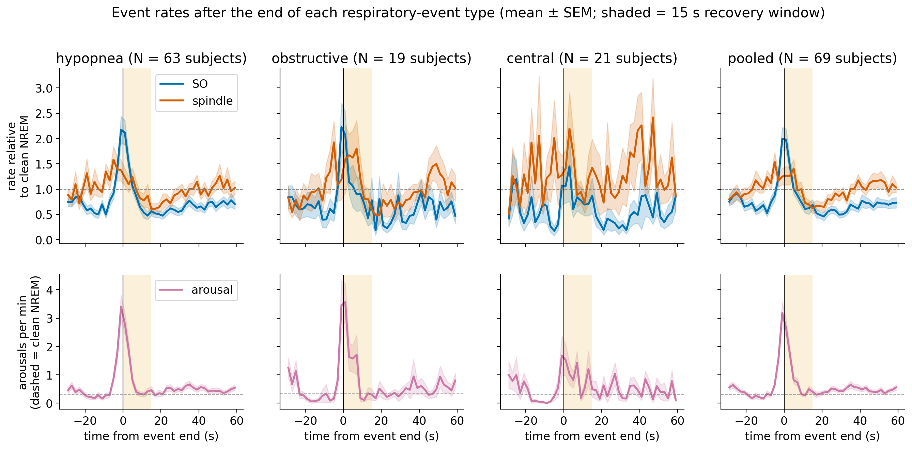{#fig-locked-type}

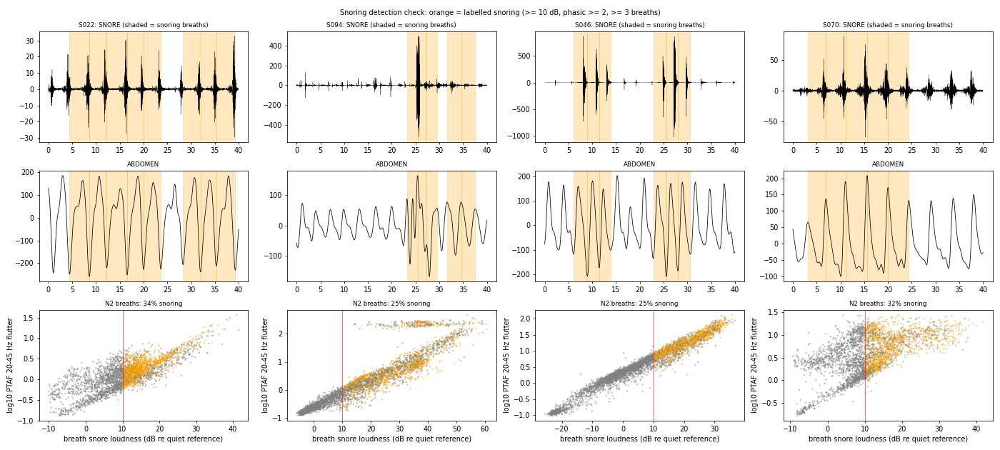{#fig-snore}

### Primary result: inconclusive

No breathing condition changed coupling after FDR correction (all FDR ≥ 0.43), but the design could not exclude a
loss. Within-subject coupling is tiny (about 0.01–0.02 per event), whereas the smallest detectable change with ~40
subjects is about 0.065. One weak trend went *against* the hypothesis: SO coupling was higher during snoring
(Δ ≈ +0.03 to +0.05, p = 0.11–0.15).


### Step 3b — more statistical power

::: {.callout-important title="Objective"}
Step 3 could not distinguish "no change" from "too little data to tell". This step aimed to increase power enough to
quantify **how much loss of coupling can be ruled out**, using stronger events, fewer and broader comparisons, and a
hierarchical model.
:::

- **More signal per event:** large SOs (≥ the subject's median amplitude); multichannel consensus events; and a
  combined `BEST` phase (FLOW gated where available, otherwise ABDOMEN gated rotated by the subject's FLOW–ABDOMEN
  offset). The primary sets were chosen on clean data only: **large SOs × BEST** (clean coupling 0.041 per event) and
  **consensus spindles × ABDOMEN** (0.024 per event).
- **Fewer, bigger questions:** apneas and hypopneas pooled into one respiratory-event condition, and a per-breath
  dose–response analysis.
- **Hierarchical model:** a Poisson GLMM of event counts per phase bin with a phase-occupancy offset, random subject
  modulation, and simulation intervals for the relative change of modulation.

**Result:** a complete loss of coupling during respiratory events is excluded (P ≤ 2 %), and a loss > 50 % is
unlikely (P ≈ 2–7 %), for both large SOs and spindles. Louder snoring was associated with *higher* SO coupling
(β = +0.025 per SD, p < 1e-4).

### Step 3c — snore-evoked events

::: {.callout-important title="Objective"}
Explain the unexpected *increase* of SO coupling during snoring. Sounds during sleep evoke K-complexes (large SOs) and
spindles, and snore bursts happen at a fixed point of inspiration. We wanted to test whether the "coupling" during
snoring is just evoked responses timed by the snore, and what remains once those are removed.
:::

Snore bursts evoke K-complexes and spindles. Large-SO troughs show an excess 0.5–1.5 s after snore-burst peaks
(p = 1e-4, N = 38), and spindle onsets an excess 0.25–1.0 s after them. Because bursts are inspiration-locked, these
evoked events create apparent coupling. They were excluded in phase-matched windows after real bursts and after
pseudo-bursts in quiet breaths. The excluded time was also removed from phase occupancy, and only
occupancy-normalised measures were used.

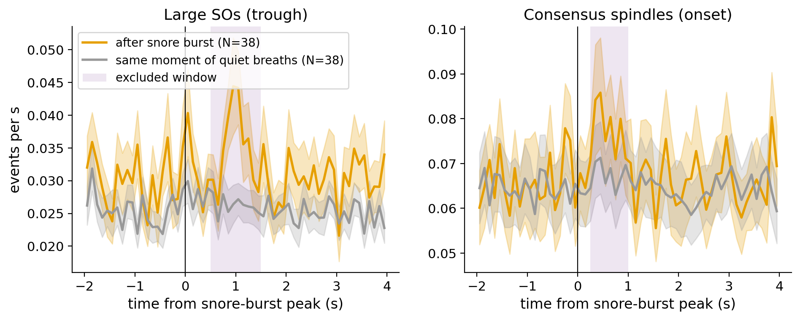{#fig-evoked}

| Snoring vs clean (N2) | All events | Snore-evoked excluded | GLMM relative change (excluded) |
|---|---|---|---|
| Large SOs | +0.021 [−0.022, 0.067] | −0.050 [−0.111, 0.008], p_loss = 0.028 | −60 % [−181, +30], p_loss = 0.073 |
| Consensus spindles | −0.016 [−0.067, 0.038] | −0.028 [−0.083, 0.028], p_loss = 0.098 | −73 % [−159, +17], p_loss = 0.052 |

: Effect of excluding snore-evoked events (condition − clean). {.striped}

### Step 3d — complexes pooled over channels

::: {.callout-important title="Objective"}
Resolve the open concern from Step 2: complexes were barely coupled to breathing. Was this because there were too few
complexes per subject, or because SOs and spindles are genuinely rarely nested in this cohort?
:::

SO troughs from F4, C4 and O2 were merged within ±0.3 s, followed within 1.5 s by a spindle on any of five channels.
This gives about 10× more complexes (median ~145 per subject in clean N2).

- **Clean coupling** is now significant: large pooled complexes × ABDOMEN, N = 70, R = 0.27, Rayleigh p = 0.005,
  V-test p = 0.001.
- **But only ~25–30 % of complexes exceed chance pairing.** With spindle times shifted at random, 16 % of SOs are still
  followed by a spindle, against 22 % observed. The complexes' preferred phase equals that of large SOs.
- **Snoring with evoked events excluded (N2+N3 GLMM):** large SOs −59 % (p_loss = 0.084), spindles −79 %
  (p_loss = 0.046), complexes −128 % (p_loss = 0.056). Apneas and hypopneas show no change.

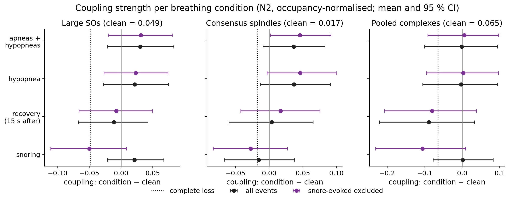{#fig-power}

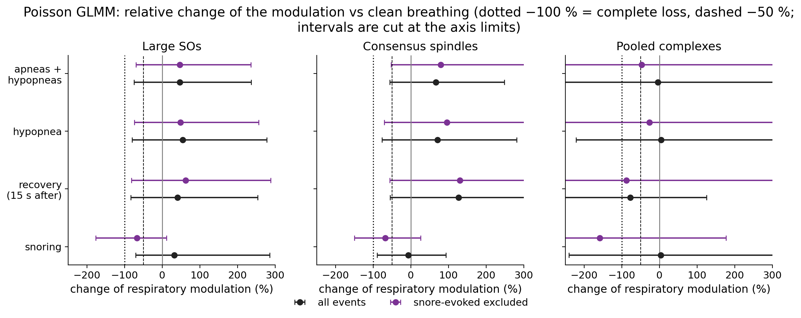{#fig-glmm}

## Step 4 — Coupling strength vs severity

::: {.callout-important title="Objective"}
Ask whether coupling is a **trait** that scales with disease severity. Repeated hypoxia and fragmented sleep could
damage the mechanism that links breathing and sleep oscillations, so patients with more severe sleep apnea would show
weaker coupling even during their undisturbed breathing.
:::

- **Coupling per subject:** occupancy-normalised clean-N2 coupling projected on the leave-one-subject-out group phase,
  for the three primary families.
- **Primary test:** robust regression on z(log1p AHI), adjusted for age, sex and BMI; BH-FDR over the three families.
- **Secondary markers, computed from the signals:** OAHI, ODI3, T90, hypoxic burden, mean event duration, snore index.
- **GLMM:** AHI as a moderator of the phase modulation.

| Family | N | β per SD log1p(AHI) | p | FDR |
|---|---|---|---|---|
| Large SOs | 88 | −0.002 ± 0.008 (clean mean 0.039) | 0.81 | 0.81 |
| Pooled complexes | 70 | +0.006 ± 0.012 (clean mean 0.053) | 0.61 | 0.81 |
| Consensus spindles | 72 | −0.005 ± 0.006 (clean mean 0.024) | 0.38 | 0.81 |

: Step 4 primary test: AHI vs clean coupling. {.striped}

Nothing survives FDR among the secondary markers (FDR ≥ 0.44). The GLMM bounds a severity-related spindle loss to less
than ~50 % per SD of log AHI (−8 % [−50, +25]).

A follow-up with plain Spearman correlations (`step4_spearman` rule) found that **direction-free** SO modulation
strength (PPC) increases with the snore index (ρ = 0.30, p = 0.004) and ODI3 (ρ = 0.28, p = 0.008). The projected
(phase-aligned) coupling does not, and nothing survives FDR over 72 correlations (FDR ≥ 0.30).

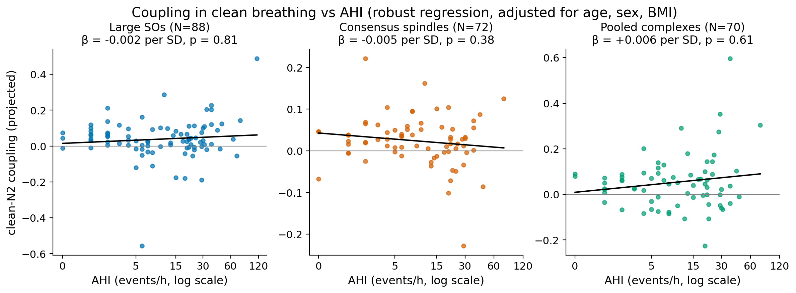{#fig-sev}

## Step 5 — Does the preferred phase change?

::: {.callout-important title="Objective"}
Step 3 measured coupling strength along the preferred phase of clean breathing. If events simply move to another part
of the breathing cycle during a condition, that measure drops although the coupling is intact. This step asked
whether the **preferred phase** shifts during apneas, hypopneas and snoring, both within individual participants and
pooled over all events.
:::

Within-subject phase differences do not depend on polarity, so all subjects were used. The control condition is clean
breathing split into alternating 10-min blocks (clean_odd vs clean_even).

- **Per participant:** each subject's condition events against their clean events (≥ 10 per group). 5a (any change):
  |Δφ| against a null calibrated with each subject's own clean-vs-clean comparison, plus the CircStat common median
  test (`circ_cmtest`). 5b (consistent rotation): a test of mean rotation ≠ 0 on the signed per-subject Δφ, plus
  `circ_mtest` and `circ_medtest` against 0. The CircStat functions were ported to Python (`snoredreamt/circstat.py`).
- **Per event (population):** the GLMM orthogonal component (condition × sin term) gives a linear, unbiased test of
  rotation.

**Results:**

- **Per participant:** no reliable change. The fraction of subjects with a changed median does not exceed the control,
  and the population of per-subject mean differences does not differ from 0 (all p ≥ 0.07).
- **Per event (GLMM, controls flat at −8° to +1°):** spindles rotate **+45° [+1, +94]** during hypopneas (p = 0.003),
  **+40°** during pooled respiratory events (p = 0.002), and **−40° [−88, −2]** during snoring (−74° with evoked events
  excluded; p = 0.027–0.054). SOs show no significant rotation.

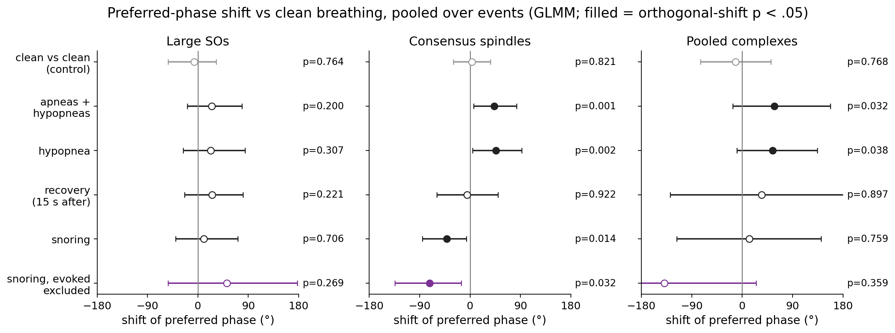{#fig-step5}

{#fig-step5cs}

## Step 6 — Phase effects vs severity

::: {.callout-important title="Objective"}
Complete the severity question for phase. Do more severe patients have a different preferred phase in clean
breathing, or a larger phase shift during disordered breathing? This also followed up a Step 4 hint that SO
modulation strength, regardless of phase, increases with oxygen desaturation.
:::

- **6a:** the signed per-subject phase change (circular–linear correlation) and its size (Spearman and rank regression
  adjusted for age, sex and BMI) against seven severity markers; BH-FDR over 315 tests. Smallest FDR p = 0.997 (N2)
  and 0.93 (N2+N3).
- **6b:** log AHI vs clean preferred phase: SOs ρ = 0.17 (p = 0.29), spindles ρ = 0.12 (p = 0.58), complexes ρ = 0.12
  (p = 0.59). AHI groups do not differ (common median test p ≥ 0.24; FDR ≥ 0.66).
- **GLMM:** AHI moderates neither the clean modulation (p ≥ 0.14) nor the condition-related rotation (p ≥ 0.08).

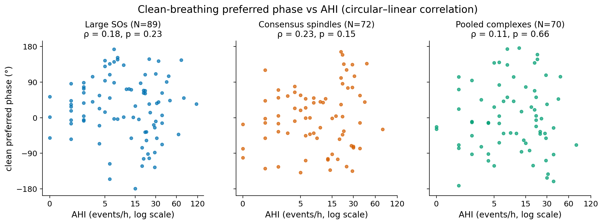{#fig-step6}

## Interpretation

Respiration coupling of SOs and spindles is present in the clinical cohort and behaves as a **state** feature of
ongoing breathing. It survives apneas and hypopneas, is not related to how severe the sleep-disordered breathing is,
and is weakened, or shifted in phase, only during snoring. The snoring result needs the most caution. Snoring
produces sounds that evoke K-complexes and spindles at a fixed point of the breathing cycle, and these evoked events
first masqueraded as *stronger* coupling. After removing them, the remaining coupling is weaker, but the windows used
to remove them were estimated from the same data.

# Workflow and reproduction {#sec-workflow}

## Project structure

| Path | Content |
|---|---|
| `Snakefile`, `config.yaml` | pipeline (one rule per step) and all parameters (one named primary analysis per step) |
| `snoredreamt/` | Python library: I/O, quality masks, detectors (slythm port), respiration phase, conditions, snoring, arousals, coupling, CircStat port |
| `scripts/rules/` | one script per Snakemake rule (Python, and R/lme4 for the GLMMs) |
| `tests/` | unit tests (34 tests) |
| `validation/` | MATLAB parity scripts (slythm detectors, CircStat) |
| `notes/` | plan, progress and per-step reports |
| `literature/` | structured notes of the key papers (PDFs not redistributed) |
| `reports/` | this report |
| `CLAUDE.md`, `.claude/skills/` | instructions and Skills for coding agents |

: Repository layout {.striped}

## Environment and data

- **Environment:** pixi (`pixi.toml`, `pixi.lock`) pins Python 3.10, NumPy/SciPy/pandas/statsmodels, Snakemake 7.32,
  R 4.5 with lme4, graphviz and Quarto.
- **Data:** DREAMT is credentialed PhysioNet data (PhysioNet Restricted Health Data License 1.5.0). It is not copied
  into the repository; it stays read-only where it was downloaded. Its location is set in `config.yaml`, and its
  integrity is given by the dataset's `SHA256SUMS.txt`.
- **Versioning:** code, configuration, reports and figures are tracked in git. Large intermediate files (cache, event
  tables) are git-ignored and rebuilt by the pipeline.

## Pipeline

Inputs (raw PSG) → cache and quality masks → event detection → respiratory phase and condition labels → coupling per
subject → group statistics and GLMMs → figures. Each box in @fig-dag is one Snakemake rule.

{#fig-dag}

| Step | Snakemake rules | Main outputs |
|---|---|---|
| 0 | `cache`, `quality` | per-subject µV cache, validity masks |
| 1 | `detect_sos`, `detect_spindles`, `complexes`, `detector_summary` | events per channel, `derivatives/step1/` |
| 2 | `resp_phase`, `resp_summary`, `arousals`, `coupling_step2`, `step2_group` | phase signals, polarity table, `derivatives/step2/` |
| 3 | `event_locked_rates`, `event_locked_by_type`, `conditions`, `conditions_summary`, `coupling_step3`, `step3_group` | `derivatives/step3/` |
| 3b–3d | `coupling_step3b`, `step3b_group`, `step3b_glmm` | `derivatives/step3b/{N2,N2N3}/` |
| 4 | `severity`, `step4_group`, `step4_glmm`, `step4_spearman` | `derivatives/step4/` |
| 5 | `step5_phase`, `step5_circstat` | `derivatives/step5/{N2,N2N3}/` |
| 6 | `step6_phase_severity`, `step6_glmm` | `derivatives/step6/{N2,N2N3}/` |
| arousals | `arousals_extended`, `arousal_agreement` | `derivatives/arousals/` |
| agent example (Section [-@sec-arousal-cycle]) | `arousals`, `coupling_step3b_arv`, `step3b_group_arv`, `step3b_glmm_arv`, `arousal_sensitivity` | `derivatives/step3b_arousal_primary/`, `derivatives/arousal_sensitivity/` |
| report | `snore_evoked_events`, `snoring_validation_figure`, `report_figures` | `figures/report/` (figures of this report, redrawn from the step tables) |

: Snakemake rules per step {.striped}

## How to reproduce

The code, pipeline, environment lock file and this report are at <https://github.com/EstebanBT/SnoreDREAMT>.

```bash
git clone https://github.com/EstebanBT/SnoreDREAMT.git
cd SnoreDREAMT
pixi install                  # environment from pixi.lock
pixi run test                 # 34 unit tests
# set paths.data and paths.participants in config.yaml to your DREAMT download
pixi run snakemake -n         # dry run: what would be built, and why
pixi run pipeline             # snakemake -j 8
pixi run dag                  # figures/pipeline_dag.png
pixi run report               # renders this report
```

## Reproducibility check

Before submission, an earlier version of the pipeline was run again in the new pixi environment. This check itself followed the agentic
cycle:

- **Inspect.** The dry run listed 300 jobs instead of none.
- **Diagnose.** The single-channel complex files for three channels added in Step 3b had never been built.
- **Bug.** One of those jobs crashed: a channel with no detected SOs (S062, T3-CZ) is saved without the
  `nrem_event` column, and `scripts/rules/complexes.py` assumed the column exists.
- **Fix.** The script now handles empty event tables, and the pipeline completes (`Nothing to be done`).
- **Result.** Step 6 and all Step 4 regression and correlation tables reproduced to ≤ 1e-4. The Step 4 GLMM
  coefficients agree to 1e-5. The only visible difference is the simulation interval of one numerically unstable
  ratio (SO modulation change per SD of AHI: [−218 %, +140 %] before, [−209 %, +147 %] now). That ratio's denominator
  is near zero, and R moved from 4.5.2 to 4.5.3.

# Working with the agent {#sec-agent}

## Agent-ready project {#sec-agent-ready}

- **`CLAUDE.md`** gives the agent the project's purpose, where to start, the commands, the data rules and the
  conventions. It also lists *scientific guardrails* that were added after the mistakes described below, for example
  "never invent reference values" and "every new test needs a negative control".
- **Progress file:** `notes/PLAN.md` holds the step table and status. `notes/STEP3_GOAL.md` is the decision log for a
  multi-day autonomous run, and each step has a report in `notes/`. They let the agent resume work across sessions,
  and they were updated at the end of each step.
- **Skill:** `literature-prep` renames PDFs to `FirstAuthor_Year`, converts them with docling and writes a
  structured summary (methods parameters, results, limitations, relevance) plus a JSON index. It was used repeatedly:
  for six papers, including the arousal-method papers, before the agent implemented that method.
- **Pipeline conventions:** every analysis is a Snakemake rule. Parameters live only in `config.yaml`, where each step
  names one primary analysis and everything else is labelled sensitivity.

## What was delegated, what I decided, how it was checked

| Delegated to the agent | Decided by me | Verified by |
|---|---|---|
| Porting my MATLAB detectors (`+slythm`) to Python | detector parameters; spindle threshold 2.0× plus spectral-peak criterion | MATLAB parity, run by me (100 % of events matched, identical thresholds) |
| Porting the arousal detector from the authors' MATLAB code | which method to use (rule-based, Fernández-Varela 2017) | agreement with the clinical arousal index (ICC, Bland–Altman) |
| Proposing detector improvements | to have them reviewed by an independent adversarial agent; to adopt the extended detection for all analyses | the reviewer re-ran the detector on all subjects and checked the claims against code and papers; full rerun compared with the original results |
| Respiratory phase, polarity calibration, condition labels, snoring detection | phase source (ABDOMEN gated Hilbert, ±0.05 Hz, my lab's standard) | example figures I inspected before each step; occupancy checks |
| Running all statistics and writing step reports | which conditions to keep; which power strategies to try (ideas 2–4 of the agent's list) | negative controls built into every test (clean-vs-clean, REM pseudo-SOs, random-time surrogates) |
| Proposing explanations for unexpected results | to exclude snore-evoked events; to pool N2+N3 and channels; to add Steps 5–6 | the agent's own follow-up tests, then my review of the figures |
| Porting CircStat tests | to use CircStat (`circ_wwtest`, `circ_cmtest`) instead of the agent's custom tests | unit tests; applicability check of each test (MATLAB parity script prepared) |

: Division of labour {.striped}

## The agentic cycle, in detail: the snoring result

1. **Specify.** Step 3 was set up as a multi-day goal with a checklist: compare coupling between each breathing
   condition and matched clean breathing, with FDR correction.
2. **Delegate.** The agent built the condition labels, the snoring detector, the matched controls and the group
   tests, and reported back.
3. **Inspect.** Contrary to the hypothesis, SO coupling was *higher* during snoring, and the agent's report showed
   that the whole contrast was inconclusive because power was low.
4. **Verify.** I asked for more power (Step 3b). The agent then tested whether snore bursts evoke events: large SOs
   appeared 0.5–1.5 s after snore-burst peaks (p = 1e-4), and SO probability rose with snore loudness.
5. **Revise.** I asked to exclude snore-evoked SOs and spindles. With that exclusion, coupling during snoring dropped
   instead of rising.

The revision itself contained a mistake. The agent kept the per-event mean-cos metric after excluding a fixed window
of the breathing cycle, which made clean coupling *negative*, an impossible result for a correct analysis. Excluding
part of the cycle makes the phase occupancy non-uniform, so only occupancy-normalised measures are valid. The fix was
switching to rate-based resultants and the Poisson GLMM. The lesson is now a guardrail in `CLAUDE.md`.

## Mistakes, and what changed in the environment

| Mistake | How it was caught | Change |
|---|---|---|
| A unit test for the CircStat port used reference values that were not computed by CircStat | review of the test file | tests now derive expected values from formulas or simulations with known ground truth; a MATLAB parity script against real CircStat output was prepared (not yet run); `CLAUDE.md` rule "never invent reference values" |
| A DOI was guessed instead of taken from the paper | review | removed; citations now come only from the processed papers (`literature/index.json`) |
| Whole-night reference phase estimated from the same clean events used as controls (circularity) | the clean-vs-clean negative control showed a "loss" of coupling | odd/even split of clean events; negative controls are mandatory (`CLAUDE.md`) |
| Rayleigh test on per-subject phase differences used to test "rotation" | the clean-vs-clean control was highly "significant" | replaced by a test of mean rotation ≠ 0 and the GLMM orthogonal component |
| Parametric null for phase change assumed independent events | anti-conservative for spindles and complexes in the control | calibrated against each subject's own clean-vs-clean result |
| Watson–Williams test (my suggestion) is invalid at the low concentrations here | the agent's applicability check and the control (28–67 % of subjects flagged) | common median test |
| Huber regression gave p ≈ 0 driven by one leverage subject (z = 4.3) | comparison with OLS-HC3 (p = 0.17) | rank regression |
| `complexes.py` crashed on channels without events | reproducibility rerun in the new pixi environment | empty event tables handled |
| I argued that the arousal detector undercounts more in subjects with many arousals, and proposed six detector changes | an adversarial reviewer agent: the ratio detected/clinical falls with the clinical index but rises with the detected one (regression to the mean), and 91 % of the "awake" rejects start in wake | no tuning of the detector rules; the plausible rejects were recovered and tested first as a sensitivity analysis, then adopted (Section [-@sec-arousal-cycle]) |
| The first arousal comparison let the clean-data rule re-select the spindle set, so the two runs compared different spindles | the number of subjects *rose* (46 → 61) when more data was excluded | event sets fixed in `config.yaml`; `CLAUDE.md` rule on holding data-driven choices fixed |
| Step 2 table p-values written from a rounded printout instead of the result table | my own check against the table before rendering | values taken from the table |

: Mistakes and method problems found during the project {.striped}

All of these were caught because the environment contained checks that could fail: negative controls, parity scripts,
tests, plots I looked at, a dry run of the pipeline, and a second agent whose only task was to attack the first one's
proposal. None of them was caught by the agent's own confidence in its output.

## A second cycle: the arousal detector {#sec-arousal-cycle}

1. **Specify.** The original detector rules (a faithful port of the published MATLAB code) found a median of 11
   arousals per hour against 28 in the clinical scoring (ICC 0.32). I asked how to make the detection agree better
   with the clinical index.
2. **Delegate.** The agent counted why candidates were rejected. Two rules each rejected more candidates than the
   detector kept: a wake rule, and a requirement for chin-EMG activity during alpha arousals. It proposed six
   detector changes on that basis.
3. **Inspect.** Before implementing anything, I had a separate reviewer agent attack the proposal. It had read-only
   access and was instructed to check every claim against the code and the papers. It re-ran the detector on all
   subjects, reproducing every count, and found two flawed arguments:
   - the claimed undercount in high-arousal subjects was regression to the mean in a ratio of two noisy measures;
   - 91 % of the wake-rejected candidates genuinely start in wake.

   Its verdict was that no detector change could be validated against a single noisy index per subject. It proposed
   the cheaper test of what matters for this project: does recovering the plausible rejects change the results?
4. **Verify.** The extended detection (Section [-@sec-arousal-det]) was run through Steps 3b/3c. My first comparison
   was wrong: the clean-data rule re-selected a different spindle set under the new exclusion. The number of subjects
   *rose* (46 → 61) although more data was excluded, which gave it away. The event sets are now fixed in
   `config.yaml`. With that fixed, nothing changed beyond the confidence intervals (@fig-arousal-sens).
5. **Revise.** The extended detection agrees better with the clinical index (ICC 0.47, bias −15/h instead of −24/h;
   @fig-arousal-cmp), so it replaced the original rules in all analyses, and the whole pipeline was rerun.

{#fig-arousal-cmp}

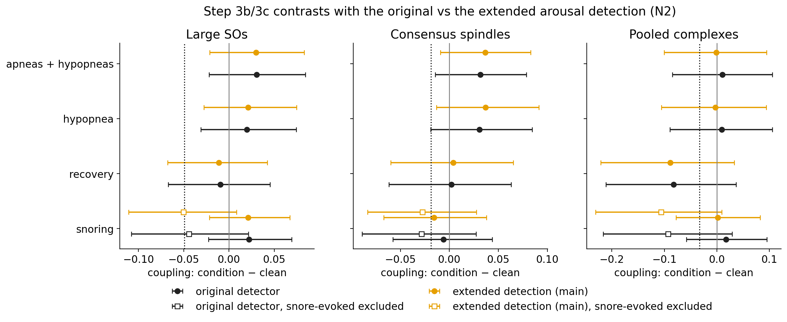{#fig-arousal-sens}

**What the switch changed.** The extended detection removes 4.7 % more clean N2 and 4.0 % more snoring N2. Compared
with the original detection:

| Step | Original detection | Extended detection (this report) |
|---|---|---|
| 2: clean coupling | SO R = 0.31, spindle R = 0.33 (FLOW Hilbert) | the same; arousal negative control now N = 87 (was 56), still null |
| 3: SO coupling higher during snoring | p = 0.02–0.07 | p = 0.11–0.15 |
| 3b: apneas/hypopneas | complete loss excluded | the same (P ≤ 2 %) |
| 3c: snoring loss, snore-evoked excluded (N2 GLMM) | SOs −68 % (p_loss 0.040), spindles −68 % (0.069) | SOs −60 % (0.073), spindles −73 % (0.052) |
| 4: severity | null; detected arousal index vs SO coupling p = 0.017 | null; that correlation gone (p = 0.06) |
| 5: spindle phase shifts | +46° hypopnea, −42° snoring (p ≤ 0.014) | +45°, −40° (p ≤ 0.027) |
| 5: CircStat | SOs in recovery differed from control (p = 0.03) | no condition differs (p ≥ 0.09) |
| 6: phase vs severity | one nominal result (SO Watson–Williams across AHI groups, p = 0.0045) | gone (p = 0.06) |

: Main results with the original and the extended arousal detection {.striped}

No conclusion changed. Three nominal side results that depended on residual arousals disappeared, and the snoring
loss became slightly weaker for SOs and slightly stronger for spindles. The reviewer predicted the change would be
"mostly cosmetic" for the conclusions, which was right. It did not anticipate the re-selected spindle set.

::: {.callout-tip title="Side example (another project): arousals after memory cues"}
In my BreathTMR study I asked the agent for a MATLAB script, in my lab's style, that detects arousals and tests
whether memory cues evoke them. It had to use EEG only, because those recordings have no chin EMG.

- **Inspect.** I ran the script, and the PETH was flat at zero before cue onset, then rose.
- **Verify.** Given access to run MATLAB, the agent traced the zeros to its own design. It had excluded every cue with
  an arousal in the preceding 10 s, which makes pre-cue arousals impossible by construction. A second problem
  (topoplots not appearing in subplots) came from a FieldTrip default that opens a new figure.
- **Revise.** The exclusion now applies only to the proportion measure, the null became an exact stage-matched
  average, and the topoplots use `cfg.figure = 'gca'`.

The lesson: the agent's code ran without errors, and only looking at the figure showed it was wrong.
:::

## Limitations of the agentic workflow

- **Analysis multiplicity.** The agent makes trying another model cheap. Steps 3b–3d and 5 together fit many models
  (families × conditions × stage sets × exclusion levels), so primaries had to be chosen on clean data and results
  reported as confirmatory-style rather than pre-registered.
- **Decisions after seeing data.** Several choices (snore-evoked exclusion windows, pooled complexes) were made after
  seeing earlier results. The reports state this.
- **Sandbox limits.** The agent could not run MATLAB inside its sandbox (no license server), so parity checks were run
  by me. Network access was restricted to what each task needed.
- **Confident prose.** The step reports read equally fluently whether the evidence is strong or weak, so their
  numbers and labels ("trend-level", "inconclusive") need checking against the output tables and figures.

# Limitations and next steps

**Scientific limitations:**

- **No ground truth for snoring.** Thresholds (10 dB, phasic 2×, 3 breaths) were not tuned, and quieter snoring stays
  in "clean".
- **Arousals.** The detection undercounts (median 20 vs 28/h clinically), so residual arousals remain in "clean" and
  "snoring".
- **Snoring loss** depends on exclusion windows derived from the same data.
- **Complexes:** most are chance pairings.
- **Phase shifts** are event-weighted population effects across many models; per-subject estimates are too noisy to
  confirm them.
- **Scoring rules:** the DREAMT hypopnea rule (3 % vs 4 %) is unknown and apnea labels were added retrospectively.
  Severe-OSA patients contribute little clean N2.

**Next steps:**

1. A sensitivity sweep of the snore-evoked exclusion windows, specified before looking at the result.
2. A stricter definition of "true" complexes (above-chance SO–spindle nesting).
3. Replication of the snoring and spindle phase-shift effects in an independent PSG dataset with snoring labels.

# References {.unnumbered}

::: {#refs}
:::
